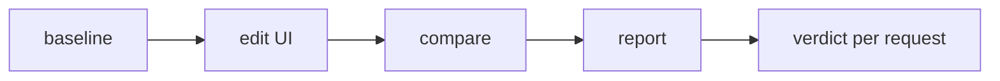
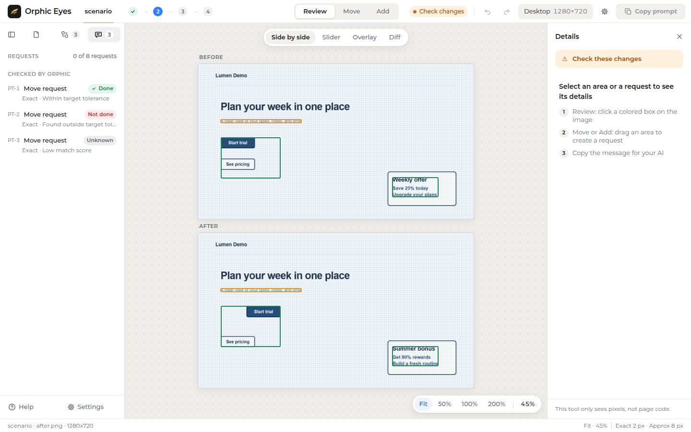

<p align="center">
  
</p>

# Orphic Eyes

*See it. Point at it. Tell the agent.*

Orphic Eyes verifies UI edits from before/after screenshots using pixels, with no
DOM, CSS or page-code inspection. Each requested change gets its own verdict,
kept separate from the visual status. The default offline HTML report lets you
review differences and prepare instructions to copy back to Hermes.

Tested with Python 3.12 and 3.14; `/orphic doctor` checks for 3.12 or newer.
Pillow is the only Python dependency, and an installed Edge, Chrome or Chromium
browser is required. Only Windows 11 with headless Edge is verified.

## At a glance

| Result | Meaning |
| --- | --- |
| Visual `pass` | No unexpected, unapproved change boxes remain. Expected or approved changes may still exist. |
| Visual `check` | Unexpected, unapproved boxes remain, below the 5% changed-pixel fail threshold. |
| Visual `fail` | Unexpected, unapproved changed pixels reach 5% of the image, or before/after dimensions differ. |
| Request `done` | Move/revert: a unique grayscale crop match scores at least 0.92 and both position offsets are within precision tolerance. Hide: the crop scores below 0.92 throughout the completed bounded search. |
| Request `not_done` | Move/revert: a unique high-scoring crop is found outside tolerance. Hide: a matching crop remains, even if its location is ambiguous. |
| Request `unknown` | Move/revert: low or ambiguous match. Any non-comment request: changed viewport or exhausted search budget. |
| Request `skipped` | Comment requests have no pixel test. |

Precision: Exact = 2 px, Approx = 8 px per axis. A request verdict does not prove
semantic identity or DOM removal; matching is local and image-only.

## How it works



The visual status describes unexpected changes; request verdicts describe whether
the requested edits can be verified. Read both before deciding what to fix.

## See it



All pages shown here are from the synthetic Lumen Demo scenario.

<!-- TODO: add move-guides.png / add-mode.png -->

## Demo

`demo/` contains synthetic **Lumen Demo** before/after pages, three request
definitions, and a script that captures them with the real engine. The scenario
produces one `done`, one `not_done`, one `unknown`, plus an unexpected subline
color change. These are demonstration pages, not a customer website.

Use Python 3.12 or newer, matching the doctor check, with Pillow installed in
that same interpreter. Run these commands from the repository root:

```powershell
python -m pip install -r requirements.txt
python -B demo/run_demo.py --repeat 2
```

The script regenerates `demo/output/` twice and checks that metrics, boxes and
verdicts agree. Open [demo/output/report.html](demo/output/report.html); the
folder also contains screenshots, crops, report.json and repeatability evidence.
Use `python` for the interpreter containing Pillow; an installed Edge, Chrome or
Chromium is also required. On Windows with several Pythons, the launcher can
select one explicitly: `py -3.12 -B demo/run_demo.py --repeat 2`.

## Point & Tell in the report UI

- **Review:** inspect visual changes, request verdicts and before/after images.
- **Move:** select an image area and describe its intended destination.
- **Add:** describe new content and where it should go. Add instructions are
  not engine requests and are not verified by the engine.
- **Copy for Hermes:** copy the instructions, paste them into Hermes and press
  Enter. Nothing is sent automatically.
- **Text size S/M/L:** adjust report text size.

Motion and animation cannot be verified from screenshots.

## Why not X?

- Agent self-checks based on tool-call logs can show that an operation ran;
  those logs alone do not establish how the screen changed.
- DOM or selector tests inspect page structure through browser or test APIs.
  Orphic Eyes compares captured pixels.
- Whole-screenshot visual-regression checks describe visual differences.
  Orphic Eyes also checks each supplied request and returns `unknown` when
  its bounded pixel matching cannot establish completion.

## Data access and disclosure

Capture starts a local headless browser (Edge/Chrome/Chromium) on this machine.
Initial URLs must be `http://localhost`, `http://127.0.0.1` or local `file://`
pages. Hermes tool calls write screenshots, crops, report.json and the optional
report.html under the Hermes data directory's `orphic-eyes/<target>/` case
folder. Standalone callers choose their store; the repository demo uses
`demo/output/`.

The plugin opens only the local URLs above and uploads no screenshots or reports.
A captured page
can itself load remote resources or follow redirects; local-URL validation
does not isolate the browser from the network. The default report has inline
CSS and JavaScript, reads embedded JSON and references adjacent local image
files, so it can be reviewed offline without a server. It copies instructions
to the clipboard rather than sending them to Hermes.

## Install

Until the repository URL and release commit are confirmed, these are placeholders:

```text
hermes plugins install <GITHUB-OWNER/REPO> --ref <FULL-40-CHAR-SHA>
```

Only after a catalog entry is merged, installation by catalog name becomes
available. The draft catalog entry is marked Windows-only:

```text
hermes plugins install orphic-eyes
```

Users on other systems can try the direct pinned-repository install above; only
Windows 11 with Edge has been verified, and operation elsewhere is unverified.

<details>
<summary>Hermes tools and engine reference</summary>

### Hermes plugin

#### Point & Tell round trip

Pass up to eight `requests` to `orphic_compare` to verify `move`, `hide` or
`revert` intents from baseline/after pixels; `comment` is skipped.
A search time budget can produce `unknown`. IDs are `PT-1` through `PT-999`.
Boxes are user-drawn hints, not DOM
elements. Read `request_results` and `requests_ok` separately from visual
`status`: an unmet request can coexist with `pass`, and a completed request can
coexist with unexpected side effects (`check`/`fail`). Matching is grayscale,
local and conservative; repeated/flat content, changed appearance and moves
outside the bounded search cannot establish a unique location. Hide proves only
absence of a matching crop inside the search window, not DOM removal. Focus PNGs
live in `crops_dir`; a default HTML report template is included at
`engine/templates/report.html`. HTML generation remains optional. See
[the report contract](docs/report-contract.md) for shapes, thresholds and examples.

Baseline additionally accepts `viewport="desktop"` (1280x720), `"mobile"`
(390x844), or `"tablet"` (768x1024), mutually exclusive with width/height.
Actual PNG dimensions are checked. Explicit presets are returned as
`viewport.preset` and retained by accept. Omitted preset preserves legacy output.

Standalone Python callers can pass `requests=[...]` to `engine.compare`;
`focus=True` enables box crops without requests and `shift_hints=True` enables
shift hints. Omitting all three leaves out Point & Tell fields; successful HTML
generation may still add `paths.html` to the returned result.
After creating the baseline, use actual local page URLs, for example:
`python -m engine.cli compare demo file:///path/to/after.html --store ./store --requests demo/requests.json`.
Request-enabled CLI calls generate focus crops and shift hints; exit codes still
follow visual status, so always inspect the independent request verdicts.

`plugin.yaml` declares the five tools registered by `register(ctx)`, in toolset
`orphic`. No hooks are registered. The only declared dependency is
`Pillow>=10,<14`. This stage does not install or enable the plugin automatically.

| Tool | When to call / arguments |
| --- | --- |
| `orphic_baseline` | Before editing UI: required `url`; optional `name="default"`, `width=1280`, `height=720`. Replaces that target's baseline and clears its previous comparison and approvals; ignore regions remain. |
| `orphic_compare` | After UI edits: optional `name`, `url` (defaults to the baseline URL), `expect=[{x,y,w,h}]`. Uses the baseline browser and viewport. A URL override affects this capture only until accepted. |
| `orphic_approve` | After reviewing changes: `name`, either `boxes=[1,2]` or `all=true`. Approves content fingerprints; does not replace the baseline. |
| `orphic_accept` | After reviewing the latest capture: `name`. Replaces the baseline with that capture, adopts its URL as the baseline URL and clears approvals. |
| `orphic_ignore` | After baseline creation: `name`, `action="add"` or `"remove"`, `region={x,y,w,h}`. Remove matches one stored rectangle (including engine clipping); compare again to recalculate. |

Use `/orphic help` for commands, `/orphic doctor` for Python/Pillow,
browser path and version, data-directory write access and engine imports, or
`/orphic demo` for two offline embedded-CSS pages whose **Start trial** button
moves 40 px right. Demo replaces only target `demo` and returns image paths/status.
It creates HTML **input pages**. `paths.report` is the absolute report.json path
when that file exists, otherwise null (such as immediately after baseline).

Successful tool calls return JSON with `success`, engine `status`, `message`,
`target`, `changed_percent`, up to 20 numbered `boxes`, `boxes_omitted`,
`paths`, `viewport` (DPR 1), and a next-step `hint`. Existing engine field names
(`name`, `summary`, flat box coordinates, `label`, `approved`, etc.) remain;
`bbox` and `kind` are additive conveniences. Request input and detailed crop
metadata remain in report.json; tool output carries verdicts and one crops_dir.
The byte budget first clears request why strings, then omits found rectangles,
then removes boxes, retaining every request ID and status. Fewer boxes may be returned to keep
the encoded result below 4,000 bytes; `boxes_omitted` counts every omitted box.
If necessary, `ignore_regions_omitted` counts omitted region entries. Full engine
comparison data remains in the target's `report.json`. Baseline/accept/ignore
responses have zero comparison metrics because they do not perform a comparison.
`success=true` means the tool ran without error. Incomplete requests are named
first in `message`; always read `requests_ok` independently of visual status.
Failures return only `success=false`, `error` and actionable `fix`. No image data
is embedded in tool results.

Storage resolves via `hermes_constants.get_hermes_home()` when importable,
otherwise `HERMES_HOME`, otherwise `~/.hermes`. Target artifacts are written
under `<home>/orphic-eyes/<target>/`; doctor may also create and probe the parent
`orphic-eyes` directory. Demo pages go under target `demo/`. Target names are
validated rather than silently renamed: 1–40 ASCII letters/digits/dash/
underscore, starting with a letter or digit, excluding Windows device names.
Linked/redirected output files and target directories are rejected. Do not
concurrently mutate or replace the same target's storage while a call is running.
The plugin stores the baseline URL in `plugin-state.json` so compare can reuse it.

**DISCLOSURES**

- Capture calls (`baseline`, `compare`, and the two captures in `demo`) start a
  headless local browser subprocess (Edge/Chrome/Chromium) per capture. Other
  tools do not capture. Commands use argument lists, never a shell or `shell=True`.
- Plugin data reads and writes stay under `HERMES_HOME/orphic-eyes` (or the
  home fallback above). Browser profiles and child-process temporary files are
  created there and cleaned up after capture. Runtime code, installed packages
  and browser executables are necessarily read outside it; explicitly supplied
  local `file://` input pages may also be read outside it.
- No network calls are made by the adapter. Initial page URLs are limited to
  `http://localhost`, `http://127.0.0.1` and local `file://` pages. The browser may
  load their resources or follow redirects: URL validation is **not** network
  isolation. The included demo has no external resources and works offline.
- No telemetry, persistent background processes, background threads, credentials
  or compiled binaries are supplied by this plugin. Capture waits for the local
  browser and cleans up its profile; a browser installation is required separately.
- Dependency: Pillow. No other new Python dependencies. Hermes provides its own
  plugin loader. Recreate baselines on each machine: browser, fonts and OS
  rendering can change pixels.
- Screenshots, source URLs, ignore regions and approvals are stored locally.
  Baseline, compare and accept operations can replace or clear artifacts.
  Input pages may themselves contain private data.

The examples below require your own page or running local server. Replace the
example URL and box IDs with values from your page and latest report. Run compare
before approving or accepting its capture. Use the Python containing Pillow.

```powershell
python -m engine.cli baseline demo file:///C:/path/to/page.html --store ./store
python -m engine.cli compare demo http://localhost:8000/ --store ./store --tolerance 0
python -m engine.cli ignore add demo --store ./store --region 30,150,330,190 --label button
python -m engine.cli ignore list demo --store ./store
python -m engine.cli ignore remove demo --store ./store --label button
python -m engine.cli compare demo http://localhost:8000/ --store ./store --expect 30,150,330,190 --expect 900,0,100,100
python -m engine.cli approve demo --store ./store --box 1 --box 2
python -m engine.cli approve demo --store ./store --all
python -m engine.cli accept demo --store ./store
python -B -m unittest discover -q
```

CLI exit codes are 0 (pass), 1 (check), 2 (fail), and 3 (error). Successful
commands print JSON; errors print one line on stderr. Baseline creation returns
pass. Reports always follow schema version 1 in `engine/report_json.py`.

The package exports `capture`, `baseline`, and `compare`. Capture returns a bool;
baseline and compare return dictionaries, with `{"status": "error", "error":
"reason"}` on failure. Pixel comparison is also available as
`engine.compare.compare_images(before_png, after_png, diff_png, tolerance=0)`.

The Python `baseline` API additionally accepts keyword-only `width` and `height`;
its defaults remain 1280x800. The CLI defaults and exit codes are unchanged.

Each case is stored in `<store>/<name>/`. Names contain ASCII letters, digits,
underscores, and hyphens, start with a letter or digit, and cannot be Windows
device names. Store outputs cannot be symbolic links, external junction targets,
or hard links. The store root is resolved before checking case paths. Callers
must not concurrently modify or replace store paths during an operation.

Implementation choices where the brief left details open:

- Default baseline `viewport` is `{"width": 1280, "height": 800}`; explicit
  sizes or Hermes viewport presets override it. `browser` is the executable path
  and `os` is `platform.system()`. Baselines use tolerance 0. Comparisons reuse
  the recorded browser and viewport and record their own time/tolerance.
- Tolerance is an integer from 0 to 255. PNG inputs are converted to RGB, as in
  the reference. Status uses the unrounded pixel percentage; reported page and
  box percentages are rounded to three decimals.
- The unchanged background of a diff is the after image at 35 percent brightness.
  Changed pixels are solid red.
- A size mismatch reports the after-image size, zero counted pixels, zero percent,
  no boxes, and `note: "size_mismatch"`. Its diff is the dimmed after image.
- For low-level output APIs, the supplied output parent is the caller-designated
  store location. Capture creates its isolated profile there and gives the browser
  that same directory for TEMP/TMP/TMPDIR. It removes stale screenshots before
  launching and verifies a resulting PNG before returning true. Browser command
  flags and timeout/kill behavior are unchanged from the reference.

HTML fixtures include the reference-derived page_a/page_b/page_real pages,
move and pattern pairs, and a report embedding fixture; page_a/page_b differ by
an 8 pixel shift. Real-browser tests require an installed browser: some fail if
one is unavailable, while others explicitly skip. Automated test outputs use
temporary directories under this project or in system temporary storage and
are removed after testing; capture profiles stay beside their output PNGs and
are cleaned up after capture. On environments that restrict browser child
processes, run tests with permission to launch the installed browser normally.

Stage 3 adds `ignore_add(name, store_dir, region, label=None)`, `ignore_list`,
`ignore_remove(name, store_dir, label)`, `approve(name, store_dir, boxes=None,
all_boxes=False)`, and `accept(name, store_dir)` to the public package. Like the
existing APIs, these return dictionaries and never raise on bad input.
`compare(..., expected_regions=[(x, y, w, h), ...])` accepts per-run expected
regions; rectangle dictionaries are also accepted. Low-level `compare_images`
also accepts `ignore_regions`, `expected_regions`, and `approvals` keyword lists.

Ignore configuration is a JSON list of `{name, x, y, w, h}` in `config.json`.
Coordinates must be nonnegative integers and sizes positive integers. Ignore
regions are clipped to the baseline when added; a wholly outside region is an
error. Omitted labels use the first available `region-N`; labels are unique and
case-sensitive. Missing labels on removal are errors. At most 50 ignores are
allowed. Comparisons clip all regions to the after image and omit regions with
no intersection. Expected regions have no persistence or count limit.

Approvals are a JSON list of `{x, y, w, h, sha256}` in `approvals.json`; hashes
are lowercase hexadecimal SHA-256 of the entire RGB crop, including unchanged
pixels inside its bounds. Repeating an identical approval does not duplicate it;
different crop hashes at the same coordinates can coexist. Both JSON files use
a same-directory temporary file and atomic replacement. Commands require an
existing case. Invalid inputs are rejected before any output is changed.

Approval uses the last report's tolerance and retains expected labels for boxes
with matching geometry during that report regeneration. If the box layout has
changed, run compare again before approving IDs. Subsequent compare calls need
their own expected regions. Accept preserves ignore configuration, copies the
current PNG exactly, clears approvals, and updates baseline time and viewport to
the accepted image. It clears the old diff and crops and writes a passing,
zero-change report with `note="baseline_accepted"` and `images.diff=null`.
Individual file replacements are atomic; a command updating several files is
not a multi-file transaction.

Only unexpected, unapproved tile-cluster pixels contribute to the 5 percent fail
threshold; this avoids counting pixels twice when box bounds overlap. Any
remaining unexpected, unapproved box gives check. Otherwise status is pass,
with `only_expected_changes` when boxes remain (including approved boxes).
Changed-pixel summaries still include expected and approved changes. The core
report schema remains version 1; optional Point & Tell fields may be added.
Approval CLI exit codes reflect the regenerated report status; ignore and accept
commands return 0 on success.

</details>

## Limitations

- Verified on Windows 11 with Microsoft Edge (headless). Browser discovery
  paths alone do not establish platform or browser support.
- Linux is unverified; an earlier cloud sandbox run was reported to fail during
  browser capture. macOS is untested.
- Capture is viewport-only, with DPR 1; full-page capture is not implemented.
- Initial URLs must be local `file://`, `http://localhost`, or
  `http://127.0.0.1`. As disclosed above, this is not browser network isolation.
- Pillow is the only Python dependency; an installed browser is also required.
- Analysis is image-only: pixels, with no DOM, CSS or page-code inspection.
  Motion and animation cannot be verified from screenshots.
- Precision: Exact = 2 px, Approx = 8 px per axis. Bounded grayscale crop
  matching cannot reliably locate flat, repeated, altered or off-window content.
- The HTML report is optional. HTML generation failure never fails compare:
  the JSON comparison remains available and the response includes `html_error`.

## Roadmap

Plans, not current features:

- Multi-frame capture for animation.
- An `add` request kind in the engine.
- Attempt history for the fix loop.
- Save-report export.
- CI on Linux and macOS.
- Chrome/Chromium support, including real-browser validation of the existing
  discovery and launch paths.
