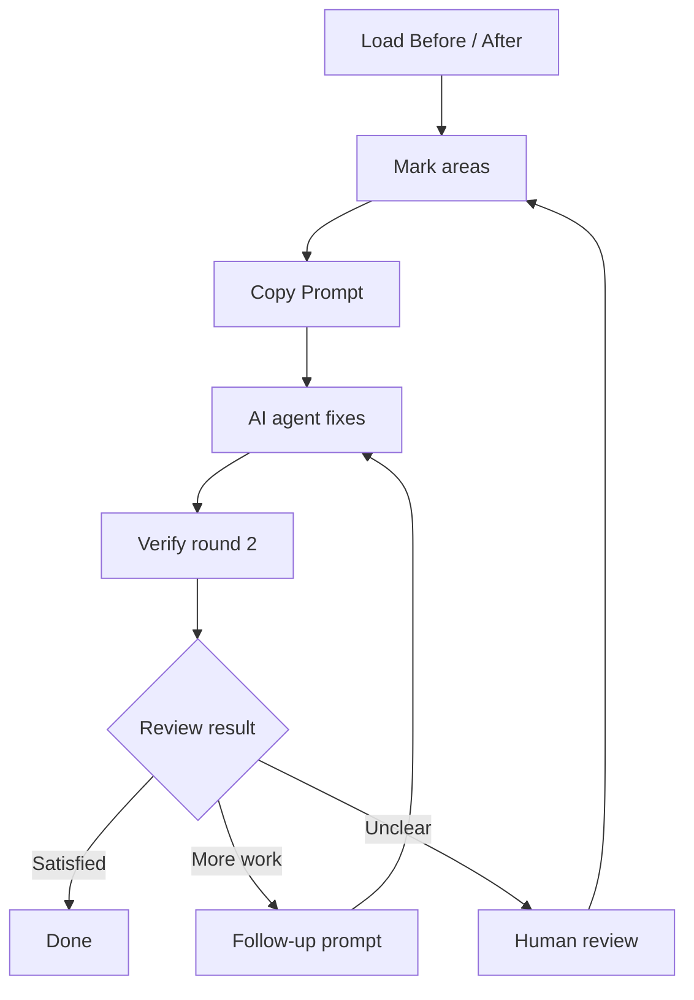
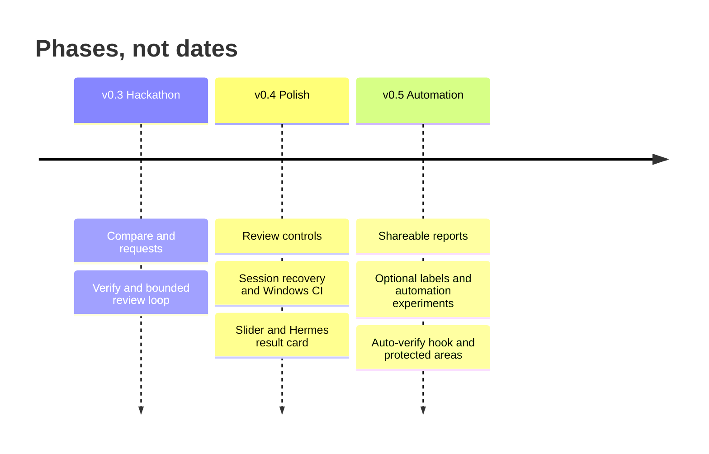

# Orphic Eyes · Roadmap

Turn visual feedback into precise requests, then check the next screenshot. Orphic Eyes aims for a dependable loop: compare pixels, describe a change, and review the result. Keep processing local where possible and uncertainty visible. Pixels never prove page code, text meaning or correctness.

**Legend:** ✅ shipped · 🔨 next · 🧭 later · 💡 idea
**Size:** S small · M medium · L large effort; no delivery promises.

| Phase | Status | Focus |
| --- | --- | --- |
| v0.3 Hackathon | ✅ Shipped features below | Compare, request, verify |
| v0.4 Polish | 🔨 Next | Easier everyday review |
| v0.5 Automation | 🧭 Later / 💡 ideas | Repeatable checks through Hermes |

## The review loop

An authorized agent applies edits. Orphic Eyes returns evidence/prompts, never executes fixes. Add needs human review.

## Shipped in v0.3.0

Verified at `fix/test-reliability` / `5736938`, with release UI `effa230`. Implementation status only; catalog admission and native Windows certification remain pending.

| Status | Feature | What exists |
| --- | --- | --- |
| ✅ | Before / After compare | Pixel diff, changed boxes and 3×3 zones |
| ✅ | Move / Revert / Add | Move drafts; Content check Revert; copied Add instructions (not an engine request type) |
| ✅ | Copy Prompt | One plain prompt with preview and options; copying sends nothing |
| ✅ | Verify round 2 | Next screenshot, verdicts, unexpected changes and follow-up prompts |
| ✅ | Content check | Looks removed / added / changed, from pixels; no OCR |
| ✅ | URL capture | `capture-pair` captures equal viewports and creates a report |
| ✅ | Bounded review loop | `orphic_loop_step`: verdicts, follow-up prompt, stop condition; Hermes coordinates edits |
| ✅ | Lumen sample | Embedded Before / After pair, available offline |
| ✅ | Rebindable shortcuts | Edit bindings, detect conflicts and reset |
| ✅ | Light / dark theme | Header toggle and saved preference |
| ✅ | Settings | Saved local preferences, including canvas and prompt options |
| ✅ | Snap to element | Pixel-based suggestion for Move/Add; accept or keep the manual box |

Sources: [README](../README.md), [report UI](../engine/templates/report.html), [CLI](../engine/cli.py), [tool definitions](../orphic_tools.py), [loop engine](../engine/loop.py). UI Verify and engine verdicts are separate.

## Next · v0.4 Polish

| Status | Work | Why | Size |
| --- | --- | --- | --- |
| 🔨 | Snap polish: tune accuracy, Alt to keep manual | Improve suggestions; retain manual control | S |
| 🔨 | Changes filter: All / Unexpected / Approved | Focus review beyond the existing zone filter | S |
| 🔨 | Local autosave of the review session | Restore images/drafts/rounds; preferences already persist | M |
| 🔨 | Hide and Comment request creation in the UI | Expose existing engine intents | M |
| 🔨 | Native Windows test coverage in CI | Catch browser, cleanup and path differences | M |
| 🔨 | Before / After slider in the report | Compare one area by dragging instead of switching views | S |
| 🔨 | Compact result card for Hermes chat | One PNG with boxes and a PASS/FAIL bar, readable in Hermes Desktop or CLI without opening the report | M |
| 🔨 | macOS test run, then add `macos` to platforms | Claim only platforms verified on real hardware | M |

## Later · v0.5 Automation

| Status | Work | Why | Size |
| --- | --- | --- | --- |
| 🧭 | Export report as a shareable file | Bundle images/evidence; current reports are folder bundles | M |
| 🧭 | Optional URL label: host only, never path/query | Add context; **privacy decision pending** before storage/display | S |
| 🧭 | Auto-verify hook before the agent says "done" | Run compare automatically; send the agent back when unrequested changes appear | L |
| 🧭 | Protected areas | Mark regions that must not change; any change there fails the check | M |
| 💡 | Scheduled post-deploy visual check through Hermes | Compare an approved baseline after deployment | M |
| 💡 | Design-consistency automation | Flag possible spacing/colour drift across pages | L |
| 💡 | Competitor page monitoring | Watch a selected public page for visual changes | M |
| 💡 | Content/SEO visual check | Flag missing/shifted pixels; no text, metadata or search-ranking claims | L |

Ideas need explicit targets, permission, baseline ownership and notification rules. No automation schedule ships today.

Priorities can change. Keep contributions small, private by default and pixel-only; verify before marking shipped.
